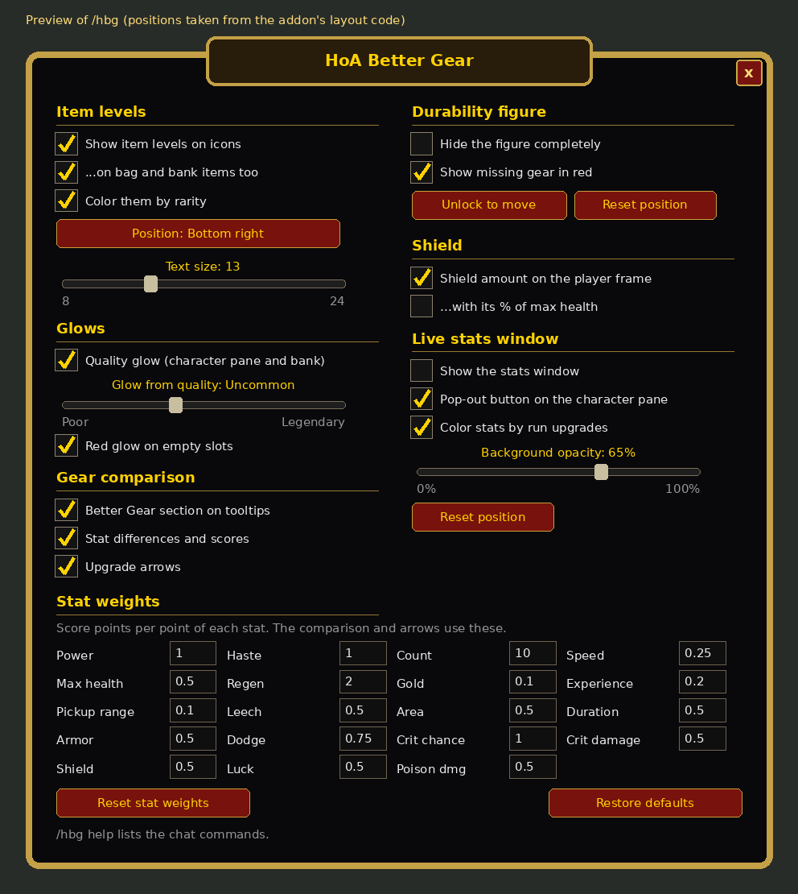

# HoA Better Gear

An addon for **Hordes of Azeroth** that helps you pick better gear:

- **Item levels**: each item's level (the `ilvl 36` in the top-right of its tooltip) is printed on its icon in its rarity color, on the character frame, in your bags and bank, and in the Extraction Vault's "Mailed to you when you leave" box, like retail item-level addons.
- **Average item level**: shown on the character pane just above Power (e.g. `Item level: 78.4`). Like retail, it covers every slot your class uses (not shirt, tabard, ammo or slots HoA locks for your class); an empty slot that needs gear counts as 0 and a two-hander counts twice. The number is colored by the average rarity of the same slots (an empty slot counts as poor), rounded to the nearest quality up to epic purple; it turns legendary orange only once every slot is epic or better and at least one piece is legendary.
- **Quality glow**: an oGlow-style colored border around equipped items on the character frame and items in your bank. HoA's bag window already has its own.
- **Missing gear on the durability figure**: the little armored figure under the minimap (which shows damaged gear yellow and broken gear red) also shows missing gear in red, using the same rules as the empty-slot glow. The addon adds a necklace, a cloak (hanging behind the body), and two rings and two trinkets (in a small column beside the feet) to the figure in the same style (dimmed when worn, red when missing), so every slot that matters has a piece. It can be moved anywhere with `/hbg move`.

  
- **Empty slot warning**: empty character slots glow red, so you can see what's missing. Shirt, tabard and ammo are left out, as are slots your class can't use in HoA (the ones it crosses out, e.g. ranged for most classes). The off hand only glows red when you're holding a one-handed weapon.
- **Gear comparison** (Pawn-style): every gear tooltip, and the **New** card in the loot window ("Wear it, carry it, or salvage it for Valor"), says how the item compares with what you have equipped, as a % upgrade or downgrade plus the difference in each stat.
- **Exact shield amount**: your current Shield is printed in cyan at the right end of the player frame's health bar (e.g. `+52`, shortened from 1,000 up: `+1.2k`, `+10.5k`, `+105k`, `+1.2m`), next to HoA's cyan shield bar, optionally with its % of your max health.
- **Run upgrade colors**: during a run, the stats on the character pane and in the live stats window change color as they grow past where they started: green from +5%, blue from +15%, purple from +30%, and orange (legendary) only once a stat is capped (Dodge 60%, Speed 50%, Pickup range 400%, Armor 300 — where its damage reduction maxes out and extra Armor turns into max health, ...). Back to white when the run ends.
- **Key stat colors**: in and out of runs, Crit chance, Crit damage and Shield turn green from 33%, blue from 66%, purple above 100% and orange from 200% (Pickup range the same, but orange at its 400% cap); Armor, Dodge and Speed turn green, blue, then purple as they get a quarter, half and three quarters of the way to their cap (Armor 300, Dodge 60%, Speed 50%), and orange at it. Haste and Area, which have diminishing returns instead of a cap (they approach 75% and 60%), do the same towards that limit and turn orange from 90% of it. Max health turns green from 100%, blue from 250%, purple from 375% and orange from 500%; Power green above 100%, blue from 666%, purple above 1000% and orange from 2000%. Luck, the only stat without a value rule, uses the run upgrade colors during a run and stays white outside one.
- **Live stats window**: a small pop-out with the character pane's stats (Power, Haste, Crit, Armor, Shield, ...) that updates in real time during a run, without keeping the character pane open. Open it with the small gold pop-out button just above the stats on the character pane, or `/hbg stats`. Drag it anywhere; it remembers where it was and whether it was open.
- **Upgrade arrows**: items in your bags, your bank and at the Mythic Quartermaster that would be an upgrade get a green arrow. In the loot window, the New item gets a green arrow and each equipped piece it beats gets a red one.

## Installation

1. Download the repository (Code → Download ZIP) and extract it.
2. Copy the **`HoABetterGear`** folder into your game's `Interface/AddOns/` directory, so you end up with `Interface/AddOns/HoABetterGear/HoABetterGear.toc`.
3. If you used the older **HoA Tier Glow** version, delete the `Interface/AddOns/HoATierGlow` folder.
4. Needs Hordes of Azeroth 0.6.0 or later for item levels (with an older version the icons show the old tier numbers).
5. Restart the game. If the addon shows as *out of date* in the AddOns list, tick **Load out of date AddOns**.

## Settings

Type `/hbg` (or right-click the stats pop-out button on the character pane) to open the settings window: every option below as checkboxes, sliders and buttons, plus the stat weights. Changes apply straight away.



## Gear comparison

Each stat has a **weight**: how many score points one point of that stat is worth. An item's score is the sum of weight × stat. A tooltip then shows, for example:

```
Better Gear: +64.4% upgrade        vs Deadwalker Mantle
   +5.3 Armor
   +9% Power
   +10.6% Max health
   Score                           43.3  vs  26.3
```

- The section sits under a gold line. The % is colored like item rarity by how big the upgrade is: white under 5%, green 5–15%, blue 15–30%, purple 30–60%, orange 60%+ (or an empty slot). Downgrades are red.
- Rings and trinkets (and both hands, for classes that dual wield) are compared with **each** item you have equipped there, one comparison per item, each under its own gold line. The upgrade arrows go by the weaker one, since that's the one you'd replace.
- Weapons follow the hands: a two-hander is compared with your main hand and off hand **together**; a one-hander or off-hand item is compared with your two-hander if you're holding one; otherwise a one-hander is compared with your main hand (either hand for Warriors and Rogues, who can dual wield). An empty slot always counts as an upgrade.
- Items your class can't use get no comparison and no arrow. Cards on the Quartermaster's Upgrade tab (your own pieces, which HoA already marks with its own arrow) are skipped.
- Stats are read exactly as HoA shows them, including the bonus lines on rolled items. Set bonuses aren't counted.

The default weights favor damage (Power, Haste and Crit chance at 1.0, most defensive stats at 0.5). Adjust them to your build:

```
/hbg weights                    list all weights
/hbg weight crit chance 1.5     set a weight (stat names can be shortened: crit, crit dmg, health, ...)
/hbg weight reset               back to the defaults
```

## Commands

`/bettergear` or `/hbg`. On its own it opens the settings window; `/hbg help` lists the commands with their current settings.

| Command | Effect |
| --- | --- |
| `/hbg compare` | Toggle the upgrade summary on tooltips |
| `/hbg diffs` | Toggle the per-stat differences and score under it |
| `/hbg arrows` | Toggle upgrade arrows (bags, bank, Quartermaster, loot window) |
| `/hbg weights` | List stat weights |
| `/hbg weight <stat> <number>` | Set a stat weight (`/hbg weight reset` for defaults) |
| `/hbg ilvl` | Toggle item level numbers (`/hbg tier` still works) |
| `/hbg avgilvl` | Toggle the average item level on the character pane |
| `/hbg bags` | Toggle item levels on bag and bank items |
| `/hbg glow` | Toggle the quality glow on the character frame and bank |
| `/hbg empty` | Toggle the red glow on empty character slots |
| `/hbg figure` | Toggle missing gear on the durability figure |
| `/hbg move` | Unlock the durability figure to drag it; type it again to lock (`/hbg move reset` puts it back under the minimap) |
| `/hbg shield` | Toggle the shield amount on the player frame |
| `/hbg shieldpct` | Also show the shield as % of max health (e.g. `+52 (41%)`) |
| `/hbg stats` | Show/hide the live stats window (`/hbg stats reset` moves it back to its default place; `/hbg stats button` hides/shows its button on the character pane; `/hbg stats opacity <0-100>` sets the background opacity, default 65) |
| `/hbg color` | Toggle rarity-colored item levels (default on; off = the gold of the tooltip's `ilvl N`) |
| `/hbg quality <0-5>` | Minimum quality that gets a glow (default `2` = uncommon) |
| `/hbg anchor <point>` | Item level position: `TOPLEFT`, `TOP`, `TOPRIGHT`, `CENTER`, `BOTTOMLEFT`, `BOTTOM`, `BOTTOMRIGHT` |
| `/hbg size <8-24>` | Item level font size |
| `/hbg debug` | List item level, stat lines and score of each equipped item |
| `/hbg reset` | Restore default settings (keeps your stat weights) |

Settings are saved per account in `HoABetterGearDB`.

## How it works

- **Item levels** are worked out exactly like HoA's tooltip: the item's tier (`VanillaBonkUI.FoundAt(bag, slot).tier` for rolled pieces, otherwise `VanillaBonkUI.GearTier(itemId)`) and its quality go through `VanillaBonkUI.ItemLevel(tier, quality)`.
- **Stats** come from `VanillaBonkUI.AddGearLines`, which writes the `+X% Stat` lines onto a tooltip. Hovered items are read from the game tooltip; equipped and bag items are read from a hidden one.
- Everything refreshes when you open the character pane or bags, change gear, move items, or when the game sends gear data (`BONK~...` system messages).
- The bank is the standard window: main slots `BankFrameItem1-24` (bag -1) and bank bags opened as `ContainerFrameN`; they're refreshed when the bank or a bank bag opens and when bank slots change.
- The Extraction Vault's "Mailed to you" slots live in `VanillaBonkVault.box.slots`; while the vault is open the addon reads each slot's tier and quality and draws its item level.
- In the Extraction Vault, HoA rebuilds each item tooltip after showing it (copying the lines, clearing them and adding its own notes), so for vault cards and "Mailed to you" slots the Better Gear section is added once HoA shows the finished tooltip, at the bottom. A piece you're already wearing (marked Equipped) is compared with your saved piece(s) instead, the "Yours:" items on the card, labelled "(saved)". No upgrade arrows are added there (any arrow on a vault card is HoA's own).
- The loot window's New card is HoA's own tooltip (`VanillaBonkGearNewTip`); the comparison is added right after HoA fills it in, so the card grows to fit.
- Quartermaster cards aren't named frames, so while that window is open the addon finds them inside `VanillaBonkQuartermasterFrame` and updates a card's arrow when its item changes.
- The shield amount comes from the `BONK~shield~<amount>` message the HoA server sends whenever your shield changes (the same one HoA draws its shield bar from).
- The stats window mirrors HoA's own stats panel (`VanillaBonkHeroStats`), so the numbers are HoA's, caps and curves included. HoA only streams run stats (`.bonk stats on`, then `BONK~stats~...` messages) and refreshes its panel while the character pane is open; while the window is open, the addon keeps the stream on and lets the panel keep refreshing.
- Run upgrade colors compare each stat with what the panel showed before the run (else the first values seen in it); runs are detected from the server's `BONK~start` / `BONK~end` messages and the in-run flag on `BONK~stats`. Caps are read from HoA's own stat tooltips ("Maximum 60%.").
- The durability figure is the game's `DurabilityFrame`: its `DurabilityFrame_SetAlerts` is wrapped to add missing pieces after the game's own coloring, and once moved, its position is kept even when the game re-anchors it under the minimap.
- Files: `Core.lua` (settings, events, commands), `ItemLevels.lua` (item levels and glows), `Compare.lua` (comparison and arrows), `Figure.lua` (durability figure), `Shield.lua` (shield amount), `StatsWindow.lua` (live stats window), `RunColors.lua` (run upgrade colors), `Settings.lua` (settings window), `DurabilityNeck.tga` / `DurabilityRing.tga` / `DurabilityTrinket.tga` / `DurabilityCloak.tga` (its added parts), `UpgradeArrow.tga` / `DowngradeArrow.tga`, `PopOutButton.tga`.
- Written for the 1.12.1 client (Lua 5.0).
- The `.tga` textures are generated by the scripts in `tools/` (`python3 tools/figure_textures.py HoABetterGear`, `python3 tools/arrow_textures.py HoABetterGear/UpgradeArrow.tga up` / `... DowngradeArrow.tga down`, `python3 tools/button_textures.py HoABetterGear`). The cloak is faded where the figure's body covers it, using the figure's layout from the 1.12 interface code.
