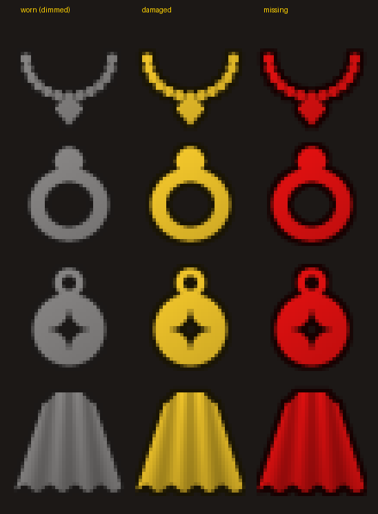

# HoA Better Gear

An addon for **Hordes of Azeroth** that helps you pick better gear:

- **Tier numbers**: each item's tier (the `Tier 10` in the top-right of its tooltip) is printed on its icon, on the character frame, in your bags and bank, and in the Extraction Vault's "Mailed to you when you leave" box, like retail item-level addons.
- **Quality glow**: an oGlow-style colored border around equipped items on the character frame. HoA's bag window already has its own.
- **Missing gear on the durability figure**: the little armored figure under the minimap (which shows damaged gear yellow and broken gear red) also shows missing gear in red, using the same rules as the empty-slot glow. The addon adds a necklace, two rings, two trinkets and a cloak (hanging behind the body) to the figure in the same style (dimmed when worn, red when missing), so every slot that matters has a piece. It can be moved anywhere with `/hbg move`.

  
- **Empty slot warning**: empty character slots glow red, so you can see what's missing. Shirt, tabard and ammo are left out, as are slots your class can't use in HoA (the ones it crosses out, e.g. ranged for most classes). The off hand only glows red when you're holding a one-handed weapon.
- **Gear comparison** (Pawn-style): every gear tooltip, and the **New** card in the loot window ("Wear it, carry it, or salvage it for Valor"), says how the item compares with what you have equipped, as a % upgrade or downgrade plus the difference in each stat.
- **Upgrade arrows**: items in your bags, your bank and at the Mythic Quartermaster that would be an upgrade get a green arrow. In the loot window, the New item gets a green arrow and each equipped piece it beats gets a red one.

## Installation

1. Download the repository (Code → Download ZIP) and extract it.
2. Copy the **`HoABetterGear`** folder into your game's `Interface/AddOns/` directory, so you end up with `Interface/AddOns/HoABetterGear/HoABetterGear.toc`.
3. If you used the older **HoA Tier Glow** version, delete the `Interface/AddOns/HoATierGlow` folder.
4. Restart the game. If the addon shows as *out of date* in the AddOns list, tick **Load out of date AddOns**.

## Gear comparison

Each stat has a **weight**: how many score points one point of that stat is worth. An item's score is the sum of weight × stat. A tooltip then shows, for example:

```
Better Gear: +64.4% upgrade        vs Deadwalker Mantle
   +5.3 Armor
   +9% Power
   +10.6% Max health
   Score                           43.3  vs  26.3
```

- The section sits under a gold line. The % is colored like item rarity by how big the upgrade is: white under 5%, green 5–15%, blue 15–30%, purple 30–60%, orange 60%+ (or an empty slot). Downgrades are red.
- Rings, trinkets and one-handed weapons are compared with the **weaker** of your two equipped items, since that's the one you'd replace. In the loot window, where you choose which slot to replace, the New card shows a comparison for **each** slot instead. An empty slot always counts as an upgrade.
- Items your class can't use get no comparison and no arrow. Cards on the Quartermaster's Upgrade tab (your own pieces, which HoA already marks with its own arrow) are skipped.
- Stats are read exactly as HoA shows them, including the bonus lines on rolled items. Set bonuses aren't counted.

The default weights favor damage (Power, Haste and Crit chance at 1.0, most defensive stats at 0.5). Adjust them to your build:

```
/hbg weights                    list all weights
/hbg weight crit chance 1.5     set a weight (stat names can be shortened: crit, crit dmg, health, ...)
/hbg weight reset               back to the defaults
```

## Commands

`/bettergear` or `/hbg`. On its own, it lists everything with its current setting.

| Command | Effect |
| --- | --- |
| `/hbg compare` | Toggle the upgrade summary on tooltips |
| `/hbg diffs` | Toggle the per-stat differences and score under it |
| `/hbg arrows` | Toggle upgrade arrows (bags, bank, Quartermaster, loot window) |
| `/hbg weights` | List stat weights |
| `/hbg weight <stat> <number>` | Set a stat weight (`/hbg weight reset` for defaults) |
| `/hbg tier` | Toggle tier numbers |
| `/hbg bags` | Toggle tier numbers on bag and bank items |
| `/hbg glow` | Toggle the quality glow on the character frame |
| `/hbg empty` | Toggle the red glow on empty character slots |
| `/hbg figure` | Toggle missing gear on the durability figure |
| `/hbg move` | Unlock the durability figure to drag it; type it again to lock (`/hbg move reset` puts it back under the minimap) |
| `/hbg prefix` | Switch between `10` and `T10` |
| `/hbg color` | Toggle quality-colored tier text (default off = the same gold as the tooltip's `Tier N`) |
| `/hbg quality <0-5>` | Minimum quality that gets a glow (default `2` = uncommon) |
| `/hbg anchor <point>` | Tier text position: `TOPLEFT`, `TOP`, `TOPRIGHT`, `CENTER`, `BOTTOMLEFT`, `BOTTOM`, `BOTTOMRIGHT` |
| `/hbg size <8-24>` | Tier text font size |
| `/hbg debug` | List tier, stat lines and score of each equipped item |
| `/hbg reset` | Restore default settings (keeps your stat weights) |

Settings are saved per account in `HoABetterGearDB`.

## How it works

- **Tiers** come from the HoA UI addon, using the same lookup as its tooltip: `VanillaBonkUI.FoundAt(bag, slot).tier` for rolled pieces, otherwise `VanillaBonkUI.GearTier(itemId)`.
- **Stats** come from `VanillaBonkUI.AddGearLines`, which writes the `+X% Stat` lines onto a tooltip. Hovered items are read from the game tooltip; equipped and bag items are read from a hidden one.
- Everything refreshes when you open the character pane or bags, change gear, move items, or when the game sends gear data (`BONK~...` system messages).
- The bank is the standard window: main slots `BankFrameItem1-24` (bag -1) and bank bags opened as `ContainerFrameN`; they're refreshed when the bank or a bank bag opens and when bank slots change.
- The Extraction Vault's "Mailed to you" slots live in `VanillaBonkVault.box.slots`; while the vault is open the addon reads each slot's tier and draws it.
- The loot window's New card is HoA's own tooltip (`VanillaBonkGearNewTip`); the comparison is added right after HoA fills it in, so the card grows to fit.
- Quartermaster cards aren't named frames, so while that window is open the addon finds them inside `VanillaBonkQuartermasterFrame` and updates a card's arrow when its item changes.
- The durability figure is the game's `DurabilityFrame`: its `DurabilityFrame_SetAlerts` is wrapped to add missing pieces after the game's own coloring, and once moved, its position is kept even when the game re-anchors it under the minimap.
- Files: `Core.lua` (settings, events, commands), `Tiers.lua` (tier numbers and glow), `Compare.lua` (comparison and arrows), `Figure.lua` (durability figure), `DurabilityNeck.tga` / `DurabilityRing.tga` / `DurabilityTrinket.tga` / `DurabilityCloak.tga` (its added parts), `UpgradeArrow.tga` / `DowngradeArrow.tga`.
- Written for the 1.12.1 client (Lua 5.0).
